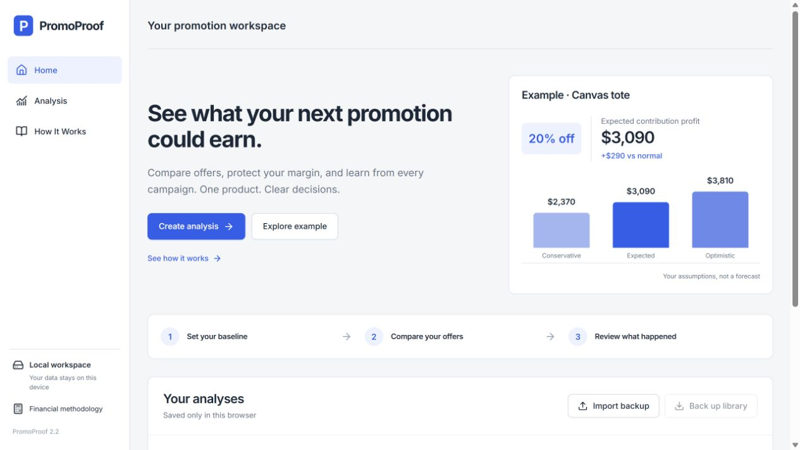
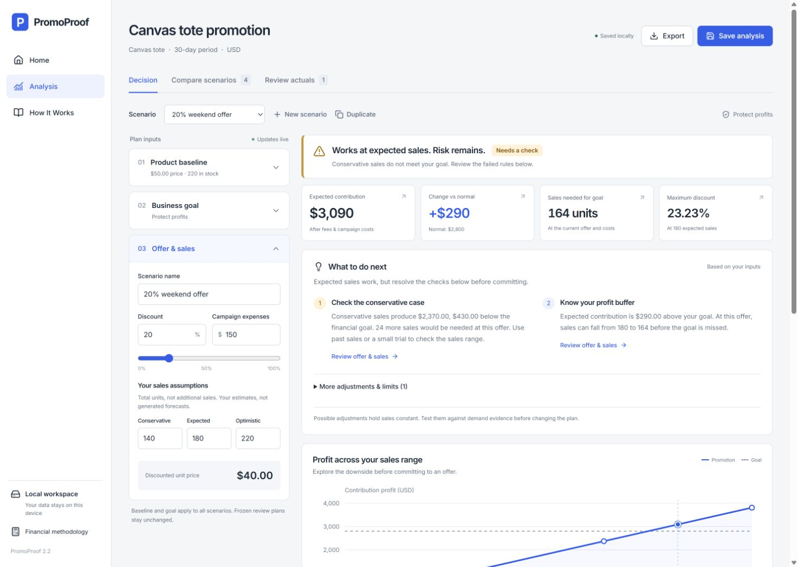
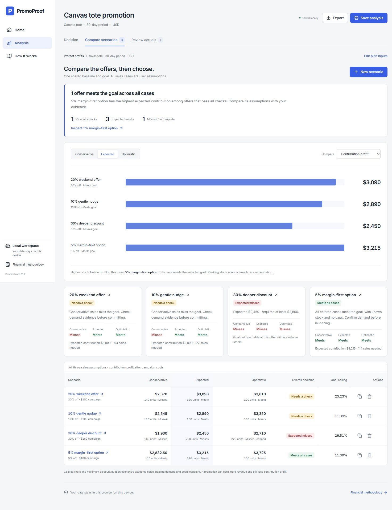
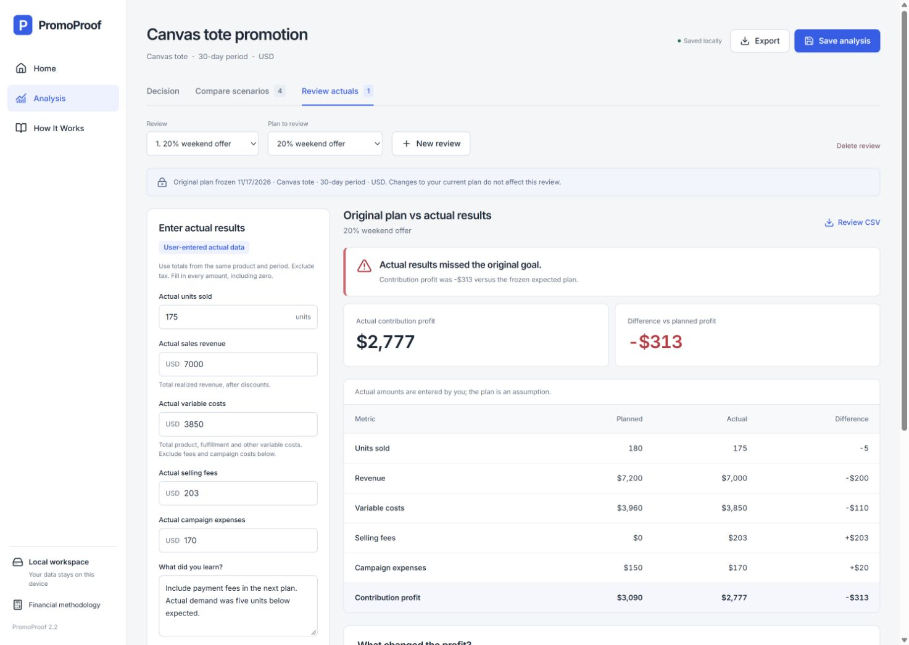

# PromoProof v2.2

**See what your next promotion could earn.**

PromoProof is a lightweight promotion decision workspace for independent retailers, online sellers, and small business owners. Compare offers for one product, understand how much you need to sell, and review what actually happened after the campaign. It uses your assumptions and transparent financial rules; it does not forecast demand.

The application runs entirely in your browser. No account, backend, installation, or subscription is required. The release includes a self-contained HTML app, complete source, tests, documentation, real application screenshots, and synthetic sample exports.



*Actual v2.2 application capture. All examples and screenshots use synthetic business data.*

## Who it is for

- A shop owner deciding whether a weekend discount can protect normal contribution profit.
- An online seller accounting for product costs, fulfillment, selling fees, and campaign spending before choosing an offer.
- A retailer clearing seasonal stock within an explicit loss budget.
- A business owner comparing planned figures with actual sales and costs after a promotion.

## Core features

| Workspace | What you can do |
| --- | --- |
| Home | Start a plan, open the worked example, reopen saved analyses, import backups, or export the library. |
| How It Works | Follow a visual product tour, enlarge actual screenshots, work through the tote example, and read plain-English financial definitions. |
| Decision | Enter a baseline, choose a business goal, test an offer, and read quantified risks and practical adjustments. |
| Compare scenarios | Compare conservative, expected, and optimistic assumptions; see goal eligibility alongside profit, profit change, and units sold. |
| Review actuals | Freeze a plan, record actual totals, and reconcile the difference without changing the original assumptions. |
| Export | Download scenario and review CSVs, a restorable JSON backup, or a PDF decision report; open a dedicated print preview. |

Version 2.2 adds practical guidance, goal-focused comparison summaries, more readable mobile controls, an illustrated guide, and a direct PDF report. The established financial, decision, storage, and CSV modules are unchanged from v2.1.

## Launch on Windows

1. Download the release ZIP and choose **Extract All** in File Explorer. Keep the extracted folder in a stable location.
2. Open **PromoProof.html** in a current version of Microsoft Edge or Google Chrome. If double-clicking opens another program, right-click the file and use **Open with**.
3. Select **Explore example**.

**Success indicator:** the canvas tote example opens with three scenarios. Its first offer shows **$3,090 expected contribution**, **+$290 versus normal**, and **164 units needed** to protect normal profit.

There is no need to install Node.js or run a command. Scripts, fonts, icons, styles, and the guide images are embedded in the HTML. A static web server can also serve this same file as `index.html`; web hosting is optional and is not enabled by this package.

**Storage note:** local-file and hosted copies have separate browser storage. Browser behavior can vary when an HTML file is moved or renamed. Keep the app at the same path, use **Save analysis**, and keep JSON backups. If local browser storage is unavailable, the app reports the problem; export your work before closing it.

**Verification boundary:** the production build and browser workflow were verified through a local HTTP preview. Direct Windows file launch and the native print dialog could not be fully verified because computer-control safety checks stopped that part of the test. The downloadable PDF report was generated, reconciled, and visually checked on every page. This limitation is recorded explicitly rather than presented as a passed check.

## Your first decision: step by step

### 1. Set a fair baseline

Choose **Create analysis** or **Explore example**. Name the analysis. In **01 Product baseline**, enter the product name, regular price, unit variable cost, normal sales, and stock available for the same comparison period.

Open **Costs & selling fees** for extra fulfillment cost, other variable cost per unit, and percentage selling fees. Add only costs that are not already included in the main unit cost. Use tax-exclusive amounts. **Period & currency** labels the analysis; changing currency does not convert values.

**Success indicator:** the baseline describes what you expect without the promotion, and the fields contain no validation errors.

### 2. Choose what success means

In **02 Business goal**, select one goal for every scenario in the analysis:

- **Protect profits:** meet normal contribution profit, or zero if normal profit is negative, plus an optional extra profit target.
- **Clear inventory:** sell the target share of available stock while staying within your maximum acceptable total campaign contribution loss.

**Success indicator:** the goal is visible above the workspace, and its threshold matches your business objective.

### 3. Enter an offer and a realistic sales range

In **03 Offer & sales**, enter the discount, additional campaign expenses, and conservative / expected / optimistic **total** sales. These are your own assumptions, not additional units and not generated forecasts. Use evidence from earlier offers, comparable periods, or a small trial.

Read the decision banner, four main metrics, and **What to do next**. Expand **More adjustments & limits** for additional checks. Guidance can quantify a profit shortfall, the extra sales required, a stock constraint, a discount ceiling, or a feasible spending reduction. Its links reopen the relevant inputs.

**Success indicator:** you can explain both why the offer qualifies at expected sales and what could make it fail.



### 4. Explore risk without changing the plan

Use the chart's sales-case buttons, slider, or exploration units field. This changes the chart probe only. Read **Why this decision** and expand **Financial details & discount limits** for the rule checks and the complete breakdown.

The tote's expected 180 units produce $3,090, but its conservative 140 units produce $2,370: **$430 below the $2,800 goal**. It needs **24 more sales** than the conservative assumption to reach the 164-unit threshold. A strong expected result therefore still receives **Needs a check**.

### 5. Compare offers against the same goal

Use **New scenario** or **Duplicate**, change the offer and its sales assumptions, then open **Compare scenarios**. Switch the sales case and comparison metric. The summary separates offers that pass every check from offers that only qualify at expected sales. Each offer also shows its downside and inventory checks.

The screenshot adds a fourth, synthetic **5% margin-first option**: 115 / 130 / 150 units and $100 campaign spending. Its $2,832.50 conservative result exceeds the $2,800 goal. It passes all entered cases, assuming those volumes are credible. The biggest profit bar alone is never a launch recommendation.

**Success indicator:** the selected promotion meets your business goal under the cases you are willing to accept, and you understand its remaining assumptions.



### 6. Save and back up

Click **Save analysis** after editing. Return Home to reopen it. Use **Export → Restorable backup · JSON** for one analysis, or **Back up library** on Home for all saved analyses.

To restore a backup, choose **Import backup** on Home and select its JSON file. Imports create copies with new identifiers; they do not replace valid saved analyses. CSV and PDF are reports, not editable backups.

**Success indicator:** the saved notification appears, the analysis survives a reload, and the imported copy retains its scenarios and frozen reviews.

### 7. Review actual results

Before recording results, open **Review actuals**, choose the intended plan, and select **Freeze plan & start review**. Fill every actual total, including zero where appropriate: units, realized revenue, variable costs, selling fees, and campaign expenses. Add your lessons, then save.

Blank actual amounts remain unknown. A review stores the original product, currency, goal, costs, and expected plan; later planning edits do not change that snapshot.

For the sample review: 175 units, $7,000 revenue, $3,850 variable costs, $203 fees, and $170 campaign spending produce **$2,777 actual contribution**. This is **$313 below the frozen plan** and **$23 below the hypothetical normal baseline**. The variance bridge reconciles revenue and cost changes; it does not establish causal promotion lift.



### 8. Export or print a decision report

Choose **Export → Decision report · PDF** for a locally generated report covering the baseline, every scenario, practical guidance, and frozen reviews. Open the downloaded file to check the result.

For browser printing, choose **Export → Print report**, inspect the clean report, then choose **Print report** in its toolbar. In the browser print dialog, use **Save as PDF** or your printer. A4 portrait is the intended layout; disable browser headers and footers if you do not want the local file address printed.

The direct PDF font supports English/Latin text and the app's currency symbols. If a product name contains an unsupported character, the app explicitly recommends the browser print route instead of silently dropping the character. Report exports contain the business figures you entered; choose where to store or share them.

**Success indicator:** the report contains the intended analysis and all scenarios, and its totals match the workspace. The included [sample PDF](sample-exports/sample-report.pdf) demonstrates the verified direct-download output.

## Financial decision models

All money uses integer-cent arithmetic with half-up rounding for unit selling prices and percentage fees. Units are whole numbers. All cases use the same product, currency, and comparison period.

Let `P` be regular price, `C` all variable costs per unit, `f` the sales-based fee rate, `d` the discount rate, and `E` additional campaign expenses. Let `q0` and `q` be normal and promotional units after inventory caps.

```text
Sale price S              = round to cents(P × (1 − d))
Normal unit fee F0         = round to cents(P × f)
Promotional unit fee F1    = round to cents(S × f)
Normal contribution B     = (P − C − F0) × q0
Promotion contribution A  = (S − C − F1) × q − E
Change versus normal      = A − B
```

Contribution is money available for fixed overhead and taxes. It is **not net business profit**. The processor's actual fee rounding may differ; reviews therefore accept ledger totals.

### Business goals and special cases

| Decision | Rule and interpretation |
| --- | --- |
| Protect profits | `A ≥ max(B, 0) + extra profit target`. A smaller loss is not labeled protected profit. |
| Clear inventory | Sell at least `ceil(stock × target share)` units and keep `A ≥ −loss budget`. Both conditions must hold. |
| Positive unit contribution | For target `T`, require at least `max(0, ceil((T + E) / unit contribution))` units. |
| Zero unit contribution | Volume cannot recover campaign costs. The goal is either already satisfied or unreachable at every volume. |
| Negative unit contribution | Each additional sale increases loss. A loss budget may create a **maximum** qualifying volume, which can conflict with the clearance target. |
| Inventory | Planning sales are capped by available stock. Entered demand remains visible. An unattainable sales threshold is explicitly flagged. |
| Maximum sustainable discount | Search the supported 0.01 percentage-point grid for the largest discount meeting the goal at expected, stock-capped sales. Demand and costs are held constant. |

The rule-based indicators mean:

- **Meets all cases:** every entered case qualifies, the range is distinct and confirmed, stock is known, and no planning sales require a stock cap.
- **Needs a check:** expected sales qualify, but downside, range, or stock assumptions need attention.
- **Expected misses:** the expected case misses the selected goal.
- **Incomplete:** required information is missing or invalid; results are withheld.

No indicator is a probability, forecast, or launch guarantee. See the [complete financial specification](docs/FINANCIAL-MODEL-v2.md) for limits, rounding, thresholds, and migration details.

## Practical business examples

| Example | Calculated finding | Practical decision |
| --- | --- | --- |
| $50 tote, $22 unit cost, 20% off, 180 sales, $150 campaign | $3,090 contribution; +$290 versus normal; goal needs 164 sales. Campaign break-even at zero profit needs only 9 sales. | Distinguish recovering campaign costs from protecting normal profit. Validate the 24-unit conservative-case shortfall. |
| Same tote at 30% off, 200 expected sales, 220 stock | $2,450 expected contribution; goal needs 227 units. Even selling all 220 earns only $2,710. | More assumed demand cannot solve the 7-unit stock shortfall. Revisit the discount, avoidable spending, or verified inventory. |
| Seasonal stock: 100 units, 60% clearance target, sale price $8, unit cost $9, $20 campaign, $100 loss budget | Profit is `−q − 20`; inventory needs at least 60 sales and the loss budget allows at most 80. | The qualifying interval is **60–80 units**. Selling 90 clears more stock but breaches the loss budget. |
| Completed tote campaign with actual fees | $2,777 actual contribution versus $3,090 planned. | Add missing fee assumptions to the next plan and investigate the sales and spending differences. |

## Data, privacy, and limits

Calculations, import, export, and saving run locally. The app contains no business-data upload, analytics, backend, or external font requests. Sharing this code package on AgentGit does not upload your browser's saved analyses. The supplied sample data is synthetic.

Saving is explicit. Browser data can be cleared or fill up, so JSON backups remain important. Limits are 100 saved analyses, 20 scenarios and 20 reviews per analysis; imports must be smaller than 20 MB. Version 1 JSON and browser storage migration are supported. New cost fields default to zero, unknown stock stays unknown, and migrated sales ranges are marked unconfirmed. Corrupt storage is reported rather than silently overwritten. CSV text cells are protected against spreadsheet formula injection.

The model covers one product at one promotion price. It does not separately model fixed overhead, taxes, returns, cross-product effects, baskets, pull-forward, replenishment timing, elasticity, or future customer value. Entered actuals and assumptions must use consistent accounting definitions.

## Development and verification

Built with React 19, Vite, native SVG charts, Lucide icons, bundled Inter, and jsPDF. Node.js 20.19+ or 22.12+ is needed **only to develop the source**, not to use the supplied HTML app.

From the extracted source folder:

```sh
npm ci
npm run dev
```

Open the local address Vite prints. To verify and build:

```sh
npm test
npm run build
node scripts/verify-package.mjs
```

**Success indicator:** 50 tests pass, and `dist/index.html` is reported as self-contained with embedded assets and no external script or stylesheet dependencies. The large-bundle notice is expected because the standalone app embeds its fonts, guide screenshots, and PDF support.

The release checks cover financial edge cases, fees, stock caps, decision rules, discount boundaries, immutable reviews, migration, imports/exports, quantified guidance, and PDF generation. Browser checks cover navigation, comparison controls, save/reload, backup restoration, review reconciliation, the visual guide, and report preview. Read [QA-v2.2.md](docs/QA-v2.2.md) for evidence and the Windows/native-print verification boundary.

## Package contents

- `PromoProof.html` — self-contained application.
- `README.md` and `START-HERE.txt` — launch and usage instructions.
- `src/`, `tests/`, `scripts/`, `package.json`, `package-lock.json`, `vite.config.js`, `index.html` — complete editable source and reproducible build inputs.
- `docs/` — financial specification, research, release notes, and embedded screenshots.
- `sample-exports/` — synthetic JSON, scenario CSV, review CSV, and PDF examples.
- `licenses/` — notices for bundled third-party dependencies.
- `MANIFEST.json` — SHA-256 hashes of the release files.

Research references are retained in [RESEARCH-v2.md](docs/RESEARCH-v2.md) and [RESEARCH-v2.1.md](docs/RESEARCH-v2.1.md). Historical design notes describe earlier versions and are labeled accordingly. This delivery preserves useful functionality and the established financial model; it does not add forecasting or automatic publication.
